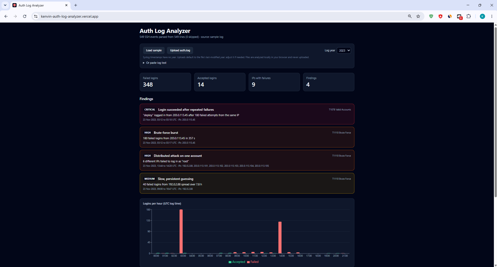
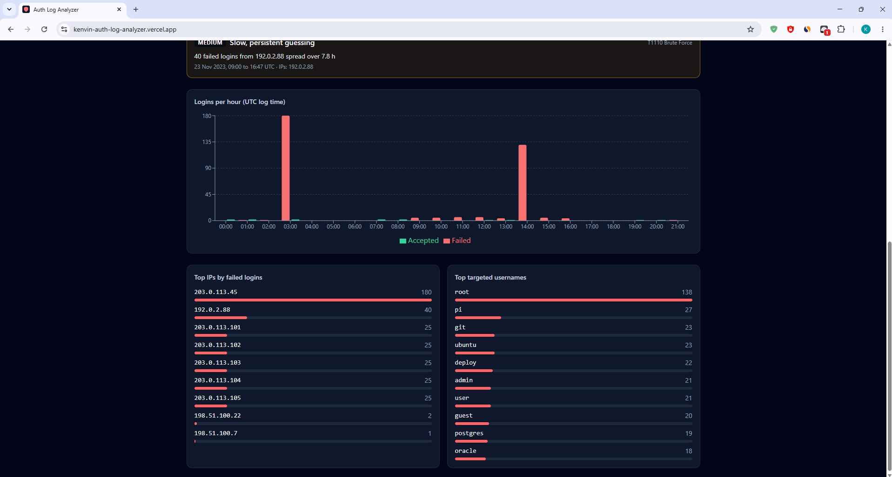

# Auth Log Analyzer

[](https://github.com/KenvinChau/auth-log-analyzer/actions/workflows/ci.yml)

**Live demo: https://kenvin-auth-log-analyzer.vercel.app/**

A browser-based analyzer for Linux SSH `auth.log` files. Upload or paste a log and it flags brute-force bursts, slow persistent guessing, distributed attacks on a single account, and logins that succeed right after repeated failures, each mapped to a MITRE ATT&CK technique. Everything runs in your browser and nothing is uploaded.



## Features

- **Four detection rules** with severities and ATT&CK technique IDs (see below)
- **Dashboard**: summary cards, findings sorted by severity, failed and accepted logins per hour, top IPs and top targeted usernames
- **Three ways in**: load the bundled sample, upload a file, or paste log text
- **Runs locally**: no backend, no upload, no tracking
- **Treats log content as untrusted input** (usernames in a log are chosen by the attacker)
- Unit-tested logic and a CI pipeline (lint, tests, build) on every push



## Detection rules

| Rule | Triggers when | Severity | ATT&CK |
|---|---|---|---|
| Brute-force burst | 10 or more failed logins from one IP within 60 seconds | High | T1110 Brute Force |
| Slow, persistent guessing | 20 or more failed logins from one IP, spread over at least 2 hours | Medium | T1110 Brute Force |
| Distributed attack on one account | 3 or more different IPs fail against the same username within 30 minutes | High | T1110 Brute Force |
| Login after repeated failures | A login succeeds after 5 or more failures from the same IP in the previous 10 minutes | Critical | T1078 Valid Accounts |

All thresholds live in one `DEFAULT_CONFIG` object in [`src/lib/detect.ts`](src/lib/detect.ts), so they can be tuned without touching the rules.

Only `Failed password` events count as attempts. An attempt on an unknown user also writes an `Invalid user` line, and counting both would double every number. Lines the parser does not recognise are skipped and counted, and the page shows how many.

## How it works

```
text ──► parseLog ──► events ──┬──► detectAll ──► findings   ──┐
                               └──► summarize ──► statistics ──┴──► React components
```

- `src/lib/` holds pure functions with no React in them: the parser, the detection rules and the statistics. They are easy to unit test.
- `src/components/` holds presentational components that only display data.
- `src/App.tsx` owns the input state and derives the analysis from it.
- `scripts/generate_sample_log.py` creates the synthetic sample log (seeded, so it is reproducible).

## Security considerations

- **Local processing.** The log is parsed in the browser. A Content-Security-Policy with `connect-src 'self'` blocks requests to other origins.
- **Untrusted input.** Attackers choose the usernames they try, so a username can be `<svg/onload=alert(1)>`. The app renders log content only as React text nodes (escaped by default) and never uses `dangerouslySetInnerHTML`. A unit test pins down that the parser keeps such a name as plain data, and I checked by hand that it displays as text.
- **Input limits.** Files and pasted text are capped at 5 MB, and read errors are handled.
- **Security headers** (set in [`vercel.json`](vercel.json)): CSP, `X-Content-Type-Options`, `Referrer-Policy`, `Permissions-Policy`, and `frame-ancestors 'none'`. The CSP allows inline styles, because the chart library sets inline style attributes. That is a deliberate trade-off.
- **Sample data is synthetic.** Addresses come from the reserved documentation ranges (RFC 5737), so no real host is ever involved.

## Known limitations

- **Thresholds are tuned to synthetic data.** Real traffic needs tuning, and many users behind one shared IP (NAT, an office) can look like an attacker.
- **Findings can overlap.** One attacker can appear under several rules, and the sample log shows this. Grouping findings per IP would be a natural next step.
- **Syslog has no year.** You pick the year (uploads default to the file's last-modified year). A log that spans New Year is read as a single year.
- **Only `sshd` authentication lines are parsed**: password and key logins, and invalid users. Other services, `sudo` and PAM messages are skipped. IPv6 addresses are untested.
- **Parsing runs on the main thread**, so a file near the 5 MB limit can briefly freeze the page. A web worker would fix that.
- **Not validated on production logs**, only on the generated sample and on unit tests.

## Tech stack

React, TypeScript, Vite, Tailwind CSS, Recharts, Vitest, ESLint. GitHub Actions for CI and Vercel for hosting. Python 3 (standard library only) for the sample generator.

## Getting started

Requires Node 22 (the version CI uses).

```bash
git clone https://github.com/KenvinChau/auth-log-analyzer.git
cd auth-log-analyzer
npm ci
npm run dev
```

Other commands:

```bash
npm test        # unit tests
npm run lint    # ESLint
npm run build   # type-check and production build
```

Regenerate the sample log (optional, same seed gives the same file):

```bash
python scripts/generate_sample_log.py --seed 42 --hours 24
```

## Project structure

```
.github/workflows/ci.yml        lint, test and build on every push
docs/                           write-up and screenshots
samples/auth.log                generated sample log (synthetic)
scripts/generate_sample_log.py  seeded sample-log generator
src/components/                 StatCards, FindingsList, HourlyChart, RankedTable, InputPanel
src/lib/                        types, parser, detect, summary, analyze (+ tests)
vercel.json                     security headers
```

More on the design decisions and the problems I ran into: [docs/WRITEUP.md](docs/WRITEUP.md).
